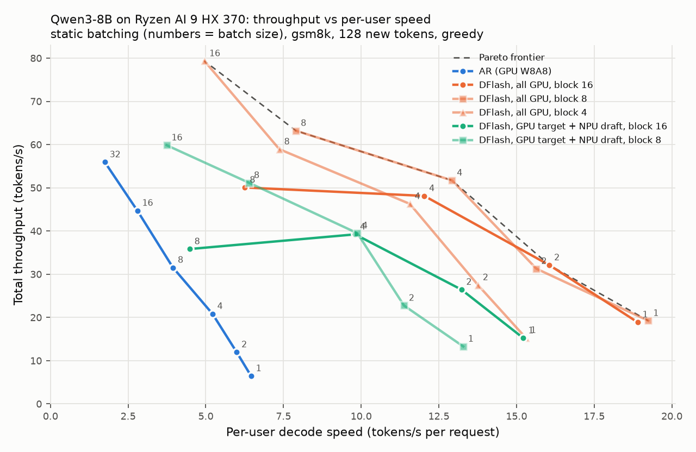

# DFlash GPU + NPU 异构方案 (Qwen3-8B, Ryzen AI 9 HX 370)

> 状态：进行中（2026-10-07，NPU draft 优化第一轮已完成，见 3.5）。本文根据两次 Claude Code 会话的日志和当前工作区代码整理，
> 目的是保存进度。数字均来自同一个 prompt（"How many positive whole-number divisors does
> 196 have? Explain briefly."），greedy，128 个输出 token，除非另有说明。

## 1. 目标

在这台 AMD APU 上跑 DFlash 推测解码，支持 `Qwen/Qwen3-8B`：

- **Target**（`Qwen/Qwen3-8B`，bf16 16 GB）→ **iGPU**（Radeon 890M，ROCm），W8A8 量化
- **Draft**（`z-lab/Qwen3-8B-DFlash-b16`，约 1B，bf16 2 GB，block=16，
  `target_layer_ids=[1, 9, 17, 25, 33]`）→ **NPU**（Strix，aie2p，mlir-aie whole_array GEMM）
- CPU 只负责胶水代码

## 2. 硬件与约束

| 项 | 值 |
|---|---|
| CPU | Ryzen AI 9 HX 370，12 线程 torch |
| 内存 | 23 GB LPDDR5X，CPU/GPU/NPU 共享（峰值带宽约 120 GB/s） |
| GPU | Radeon 890M，gfx1150，torch 2.13.0+rocm7.2，bf16 GEMM 实测 8.8 TFLOPS |
| GPU 可用显存 | **11.5 GiB**（GTT 上限）。bf16 target 16.4 GB 放不下 → 必须量化（或 root 改 `amdgpu.gttsize` 后重启） |
| NPU | `/dev/accel/accel0`，XRT 2.26.0，aie2p，按 8 列使用 |

## 3. 实测结果

### 3.1 基线（全 CPU）

| 配置 | decode | 平均接受长度 |
|---|---|---|
| 自回归，CPU | 3.17 tok/s | 1.00 |
| DFlash，target + draft 都在 CPU | 12.4–14.0 tok/s | 6.05 |

DFlash greedy 输出和自回归的前 48 个 token 完全一致，第 48 个 token 起分叉，两边都是合理的续写。
原因是 bf16 舍入：16 个 token 一起验证和逐个 token 验证的舍入不同，不是 DFlash 的 bug。

### 3.2 Profile（target 在 CPU）

| Draft 设备 | target 前向/步 | draft body/步 | draft lm_head/步 | decode |
|---|---|---|---|---|
| CPU | 364 ms (**83%**) | 51.5 ms | 22.6 ms | 13.98 tok/s |
| NPU（仅 Linear） | 383 ms | **376 ms** | 24.3 ms | 7.78 tok/s |

结论：瓶颈在 target，所以先把 target 搬上 GPU。现在的 NPU draft 比 CPU 慢约 7 倍。

### 3.3 Target + draft 都在 GPU（W8A8）

| 配置 | target/步 | draft body + lm_head | 接受长度 | decode | GPU 峰值显存 |
|---|---|---|---|---|---|
| W8A8，bf16 lm_head | 203 ms | 30 + 17 ms | 7.94 | 32.1 tok/s | 10.34 GiB |
| + int8 lm_head | 192 ms | 29 + 10 ms | 7.06 | 30.8 tok/s | 9.75 GiB |
| **+ int8 lm_head + `torch.compile`** | **164 ms** | **25 + 10 ms** | 7.06 | **35.8 tok/s** | 9.75 GiB |

- 相比 CPU target（14.0 tok/s）快约 2.6 倍。
- int8 lm_head 会让措辞略有变化，接受长度从 7.94 降到 7.06。目前**只测了一个 prompt**，
  不能确定这个下降是否真实存在。
- 单个 int8 GEMM（`torch._int_mm`）实测约 60 GB/s，内存带宽上限约 120 GB/s，还有余量。
  M=16 时各 shape 耗时（eager / 只算 int_mm / compiled，单位 ms）：
  4096×4096 0.47/0.34/0.37，4096×1024 0.21/0.12/0.12，
  4096×12288 1.03/0.84/0.86，12288×4096 1.12/0.91/0.94。

### 3.4 NPU 单层 GEMM（`NpuLinear`，rows=16，修复后）

| K × N | 相对误差 | NPU 稳态 | CPU |
|---|---|---|---|
| 4096 × 4096 | 6.8e-5 | 4.0 ms | 1.3 ms |
| 4096 × 1024 | 5.9e-5 | 1.5 ms | 0.3 ms |
| 4096 × 12288 | 4.3e-5 | 10.4 ms | 2.1 ms |
| 12288 × 4096（down_proj，按 K 切分） | 7.2e-5 | 11.7 ms | 2.2 ms |
| 20480 × 4096（fc，按 K 切分） | 6.4e-5 | 22.0 ms | 5.7 ms |
| 4096 × 4096，rows=100 | 3.9e-5 | 6.0 ms | 3.0 ms |

每个 shape 首次 JIT 编译约 5 s，之后走 `~/.npu/cache`。（以上是优化前的数据。）

### 3.5 NPU draft 优化（第一轮，2026-10-07）

**诊断**（`scripts/hetero/bench_npu_gemm.py`；M=64、k=128 下的单次调用）：

1. **瓶颈是从 DDR 读权重。** M=256 的耗时正好是 M=128 的 2 倍。上游 `whole_array`
   要求 `M % (2·m·4) == 0`，所以 16 行的激活会被补到 128 行，**每个权重都读了两遍**。
   修复办法：在 vendored 的 `dflash/npu_gemm.py` 里把 C 的输出模式改为
   `tb_n_rows = min(2, M // m // 4)`，这样 M=64 时只读一遍。
   4096×12288 层：8.3 → 4.36 ms；再把 k 从 64 改成 128，降到 3.54 ms（约 28 GB/s）。
2. **每次调用都新分配 buffer，要 0.3–1.8 ms。** 改成全局 buffer 池，用 `overwrite()` 写入（这样会标记为 host 已修改，调用前自动同步）。
3. **attention 的 k_proj/v_proj 各调用两次**（ctx 一次、noise 一次），每次都要读一遍权重。
   改为 qkv 合并：对 `[ctx; noise]` 做一次 GEMM（`model.py` 里加了 `qkv_proj` hook）。MLP 的 gate/up 也合并成一次。
4. **切换 GEMM shape 每次约 2.6 ms。** 每个 shape 是一个独立的 xclbin，NPU 要切换 hw_context。
   实测：同一 shape 连续调用 1.42 ms/次，换权重不额外花时间；两个 shape 交替调用 4.30 ms/次。
   改为**所有调用都用 64×4096×4096 这一个 shape**：权重按 N、K 都切成 4096 的块，qkv（6144）补零到 8192。每步共 65 次调用。

| 阶段（target 在 CPU） | draft forward/步 |
|---|---|
| 原始实现 | 376 ms |
| + 只读一遍权重、k=128、buffer 池、qkv/gate_up 合并 | 139 ms（其中约 55 ms 是 shape 切换） |
| + 全部调用统一为一个 shape | **101–108 ms**（GEMM 98 ms / 65 次） |

输出文本和接受长度（6.05）与 CPU draft 完全一致，单层误差约 3e-3（来自最后转 bf16 的舍入）。

**端到端（128 token，同一个 prompt）：**

| 配置 | target/步 | draft body/步 | 接受长度 | decode |
|---|---|---|---|---|
| target CPU + NPU draft | 340 ms | 101 ms | 6.05 | 13.1 tok/s |
| **target GPU W8A8 + NPU draft（异构）** | 169 ms | 106 ms | 6.68 | 23.4 tok/s |
| target GPU W8A8 + GPU W8A8 draft | 164 ms | 25 ms | 7.06 | **35.7 tok/s** |
| 对照：同一个 GPU W8A8 target 做纯 AR（`--block-size 1`） | 154 ms/token | — | 1.00 | 6.55 tok/s |

和 AR 比：异构 **3.6×**，全 GPU DFlash **5.5×**。target 前向 1 个 token 要 154 ms，验证 16 个 token 也只要 164 ms（瓶颈在带宽），所以一步验证多个 token 几乎不额外花时间。

**上限分析：** 拟合单次调用耗时，固定开销约 0.24 ms/次，带宽约 30 GB/s。
- bf16 draft 权重约 2.1 GB，按 30 GB/s 下限约 70 ms，再加 65 次 × 0.24 ms 的固定开销。
- int8（实测 i8 GEMM：4096×4096 约 0.93 ms，24576 宽约 27 GB/s）大约能到 60–70 ms。
- **两种都比 GPU draft 的 25 ms 慢 3 倍以上。** 所以在 DFlash 串行"起草→验证"的流程里，NPU draft 不可能比 GPU draft 快。NPU 要带来收益，必须让 NPU 和 GPU 同时工作（见第 7 节）。

### 3.6 Throughput vs 每用户 TPS 的 Pareto 前沿（2026-10-07）



**设置：**
- 静态 batching（`dflash/batched.py`）。每个 batch 内所有行同步推进，不同行接受的 token 数不一样，用 mask 处理。
- 每个点取 GSM8K 前 B 个问题，每行生成固定 128 个 token，greedy，不在 EOS 停。
- 只统计 decode 时间（TTFT 另记）。每用户 TPS = 128 / decode 时间，吞吐 = B × 128 / decode 时间。
- target 都是 GPU W8A8 + `torch.compile` + int8 lm_head。
- 原始数据：`docs/data/pareto.jsonl`；运行日志：`docs/data/sweep.log`。
- 复现：`scripts/hetero/pareto.py` 跑数据，`plot_pareto.py` 画图。

**正确性：**
- AR batching 和原实现逐 token 一致。
- DFlash batching 做了 teacher forcing 检查（把生成的序列整段喂给 target，看每个位置是不是 target 的 argmax）：256 个 token 里只有 2 个不是 argmax，logit 差距都是 0.5，属于 bf16 near-tie。
- 左 padding 会改变 attention 的累加顺序，再经 W8A8 动态量化放大，所以 batched 输出和 B=1 输出会在 near-tie 处分叉。这是数值噪声，不是逻辑错误。

**前沿上的点（全部是全 GPU DFlash）：**

| 配置 | 每用户 TPS | 吞吐 tok/s | 接受长度/步 |
|---|---|---|---|
| block 8, B=1 | 19.2 | 19.2 | 3.94 |
| block 16, B=2 | 16.1 | 32.1 | 4.27 |
| block 8, B=4 | 12.9 | 51.7 | 3.95 |
| block 8, B=8 | 7.9 | 63.2 | 4.23 |
| block 4, B=16 | 5.0 | **79.3** | 3.03 |

对照：
- AR：B=1 时 6.5 tok/s；B=32 时总吞吐 56 tok/s，但每用户只有 1.75。
- 异构（NPU draft）：最好的点是 block 16 B=1（15.2 TPS）和 block 8 B=16（59.9 tok/s），都不在前沿上。

**结论：**
1. **在任何每用户 TPS 下，DFlash 的总吞吐都比 AR 高。** 同样 B=8 时：block 8 的 DFlash 63.2 tok/s，AR 31.5 tok/s；最大吞吐：DFlash 79.3，AR 56.0。
2. **batch 越大，最优 block 越小**（B=1–2 用 16 或 8，B=4–8 用 8，B=16 用 4）。原因是验证的 token 数 = B × block，B 大了以后 target 前向会从受带宽限制变成受算力限制，长 block 后面那些多半会被拒的 token 开始真正占用算力。
3. **NPU draft 不在前沿上。** B=1 时 draft 每步 112 ms，GPU draft 只要 27 ms。B 增大时，NPU 的行数补齐到 64 的 2 的幂，超过 64 行就要多读几遍权重，所以 B=8 时 draft 每步涨到 318 ms。只有 block 8、B=16 这个点，因为 draft 不占 GPU 显存，能跑到 GPU DFlash 同 block 跑不到的 batch。
4. **GSM8K 上的接受长度（block 16 时 4.3–5.2）比之前单个 prompt（6–7）低**，所以 DFlash 在 B=1 时的加速是 2.9×，比单 prompt 时的 5.5× 低。
5. **batch 上限受 GPU 显存约束**（11.5 GiB，target 就占约 9.75 GiB）。DFlash 在 block 16/8 时 B=16 OOM，block 4 时 B=32 OOM。lockstep 实现会把被拒的 token 留在 KV cache 里（只是 mask 掉），每步都占满 block 个 slot。如果改成压缩 cache，还能把 batch 再往上推。

## 4. 异构架构

```
              ┌──────────── GPU (890M, W8A8) ─────────────┐
 prompt ──►   │ target prefill / 16-token verify           │
              │   → hidden states of layers 1,9,17,25,33   │──┐ context feature
              │ target lm_head（draft 共用）                │  │ (≈16 × 5×4096 bf16 / step)
              └───────────────▲────────────────────────────┘  │
                              │ draft hidden → logits          ▼
              ┌───────────────┴──── NPU (aie2p, 8 cols) ──────────────┐
              │ draft body：fc / qkv(合并) / o / gate_up(合并) / down    │
              │ 全部为 64×4096×4096 bf16 GEMM，f32 输出；                │
              │ norm / RoPE / attention / SiLU 仍在 torch 侧             │
              └───────────────────────────────────────────────────────┘
```

- 每一步都有串行依赖：draft 需要 target 上一步验证后的 hidden states，target 又需要 draft
  的提议才能验证。所以**不改算法的话，GPU 和 NPU 不能同时工作**。
- 在 GPU 方案里 draft 只占每步约 35/200 ms（<20%）。就算 NPU 把 draft 的时间降到 0，
  端到端最多也只快 15–20%。而 NPU draft 要降到 25 ms 以下才能打平，按 3.5 节的上限分析做不到。
- 把 draft 放到 NPU 的其他好处：GPU 能腾出约 1 GB 显存（给更长的 KV cache 或 bf16 lm_head），
  并为以后的流水化留出空间，例如让 draft 预先起草下一块，验证通过就直接用（需要改算法）。
- 三个设备共用同一块 LPDDR5X，所以 GPU 和 NPU 之间原则上可以零拷贝。
  目前的实现是 GPU → CPU numpy → NPU buffer，每层都要拷一次。

## 5. 代码现状

### 5.1 `dflash/` 包（已推到 HSA_dflash）

| 文件 | 改动 |
|---|---|
| `dflash/npu_gemm.py`（新增） | 从 mlir-aie `whole_array.py` vendored 过来（保留 Apache-2.0 WITH LLVM-exception 头），去掉 CLI。唯一改动：`tb_n_rows = min(2, M // m // 4)`，让 M=64 时只读一遍 B。 |
| `dflash/npu.py`（新增） | `NpuLinear`：权重预切成 4096×4096 的 bf16 块，所有调用都是同一个 shape（m,k,n=16,128,64，8 列，`b_col_maj=1`，f32 输出）；行数补到 64 的 2 的幂倍；A/C buffer 全局复用；K 方向的部分和在 host 上累加。`NpuLinear.fused`：合并多个共享输入的 Linear。`NpuMLP`：gate/up 合并 + down。`offload_draft(model)`：替换 attention（设置 `qkv_proj`）、MLP 和其余 Linear（如 `fc`）。 |
| `dflash/model.py` | `_cuda_time()` 在没有 GPU 时跳过 synchronize；`Qwen3DFlashAttention.forward` 里如果有 `qkv_proj`，就用一次 GEMM 算 `[ctx; noise]`。 |
| `dflash/cli.py` | 新增 `--device`（默认 `cuda:0`）和 `--draft-device {same,npu}` |
| `dflash/benchmark.py` | `load_transformers_models(..., draft_device)`：传 `npu` 时，先在 CPU 上调用 `offload_draft`，再 `.to(device)`，这样 draft 的 bf16 权重不会占用 GPU。 |

### 5.2 `scripts/hetero/`（从会话日志还原）

原来放在 `/tmp` scratchpad，已被清掉，后来通过回放会话日志还原。`profile_dflash.py` 和 `gpu_w8a8.py` 还原后已经实际跑过，结果与原来一致（35.7 tok/s）。

| 文件 | 作用 |
|---|---|
| `gpu_w8a8.py` | `W8A8Linear`：权重 int8，按输出通道对称量化；激活 int8，按 token 动态量化；用 `torch._int_mm` 计算，M 至少补到 32 且对齐到 8。`load_target_w8a8` / `load_draft_w8a8` 先在 meta 上建空模型，再逐个 tensor 流式量化到 GPU（避免 16 GB 的 bf16 整体进内存；早先因为 buffers 字典持有 GPU 占位张量而 OOM，已修）。lm_head 按 8192 行分块量化。环境变量 `W8A8_COMPILE=1` 打开 `torch.compile(dynamic=True)`。 |
| `profile_dflash.py` | 分阶段计时：target_fwd、target lm_head、draft_body、draft_lm_head、other。参数 `--device`、`--draft-device`、`--w8a8`；环境变量 `W8A8_HEAD=1` 把 lm_head 也量化成 int8。会先用相同长度跑一遍预热。 |
| `run_dflash.py` | 冒烟测试：DFlash 与自回归（`block_size=1`）对比，报告第一个分叉的 token |
| `test_npu_linear.py` | 测 `NpuLinear` 各 shape 的精度和延迟，与 CPU 对比（旧 API，可能需要更新） |
| `bench_npu_gemm.py` | 单次 GEMM 调用的分阶段计时（调用本身、写 A、读 C、分配 buffer），可选 `--dtype bf16/i8` 和 M/K/N/m/k/n |

### 5.3 还没做的

- `gpu_w8a8.py` 还没有并入 `dflash/` 包或 CLI（例如 `--target-quant w8a8`）。异构组合目前只能通过 `profile_dflash.py --w8a8 --draft-device npu` 运行。
- 质量只验证过 1 个 prompt。
- 激活在 GPU → CPU → NPU buffer 之间仍然要拷贝（每次调用都有），还没做零拷贝。

## 6. 运行环境

VM 重启后只有 `/notebooks` 会保留。持久化的配置放在 `/notebooks/.persist/`，由 `claude-env.sh` 自动 source：
`GIT_CONFIG_GLOBAL`（git 身份和 GitHub SSH key）、`HF_HOME=/notebooks/.cache/huggingface`，以及 `dflash_env` 函数。

```bash
source /notebooks/claude-env.sh
dflash_env   # source XRT，设置 IRON/XRT 的 PYTHONPATH 和 PATH，然后 cd /notebooks/dflash

# GPU W8A8（当前最好配置，35.8 tok/s）
W8A8_COMPILE=1 W8A8_HEAD=1 PYTHONPATH=scripts/hetero:$PYTHONPATH \
  .venv/bin/python scripts/hetero/profile_dflash.py --device cuda --w8a8

# CPU target + NPU draft
PYTHONPATH=scripts/hetero:$PYTHONPATH \
  .venv/bin/python scripts/hetero/profile_dflash.py --device cpu --draft-device npu
```

注意事项：
- dflash 的 `.venv`（torch-ROCm + transformers）里额外装了 `ml_dtypes aiofiles rich cloudpickle`，这样 IRON 才能 import。
- 找不到 `pyxrt` 时，IRON 会**静默**退回到只有 CPU 的 tensor 类，然后报 `Unsupported device: npu`。
  所以一定要先 source XRT，并把 `/opt/xilinx/xrt/python` 加进 PYTHONPATH。
- checkpoint 在 `$HF_HOME/hub/`（`/notebooks/.cache/huggingface`）。原来放在 `~/.cache`，VM 重启时丢了，
  2026-10-07 已重新下载到持久盘。下载完成后可以设 `HF_HUB_OFFLINE=1`。
- `~/.npu` 下的 NPU JIT 缓存不在持久盘上，重启后每个 GEMM shape 要重新编译一次（约 5 s）。

## 7. 下一步（待定）

路线：1）profile ✅ → 2）target 上 GPU ✅ → 3）NPU draft 优化（第一轮 ✅：376 → 101 ms）

NPU draft 在串行流程里打不过 GPU draft（第 3.5 节）。接下来可以选的方向：

1. **让 GPU 和 NPU 同时工作（真正的异构）**：GPU 验证第 t 块时，NPU 已经开始起草第 t+1 块，
   类似 PEARL 的 pre-verify / post-verify。难点是 DFlash 的 draft 依赖已验证 token 的 target hidden
   states，所以提前起草只能用旧的上下文，接受率可能下降，需要实验。另外 GPU 和 NPU 同时运行时会抢 DDR 带宽。
2. **继续压 NPU draft**（只有走方向 1 时才有意义）：
   - 改成 W8A8 int8，预计约 60–70 ms
   - 同一个 xclbin 配多组 insts，这样不同 N 不用补零、也不用切换
   - 用 shim 的第二个 MM2S 通道提高带宽
   - 零拷贝
   - 把 SiLU、norm 也放到 NPU 上
3. **回到 GPU target 优化**（Pareto 前沿全是 GPU DFlash，target 前向占每步大部分时间）：合并 qkv、gate/up，写 Triton int8 kernel，目标是接近 120 GB/s。这对端到端速度最直接。
4. **并入代码，用多个 prompt 验证质量。**
5. **batched DFlash 的显存优化**：压缩 KV cache，丢掉被拒 token 的 slot；按 batch 大小自动选 block size。
